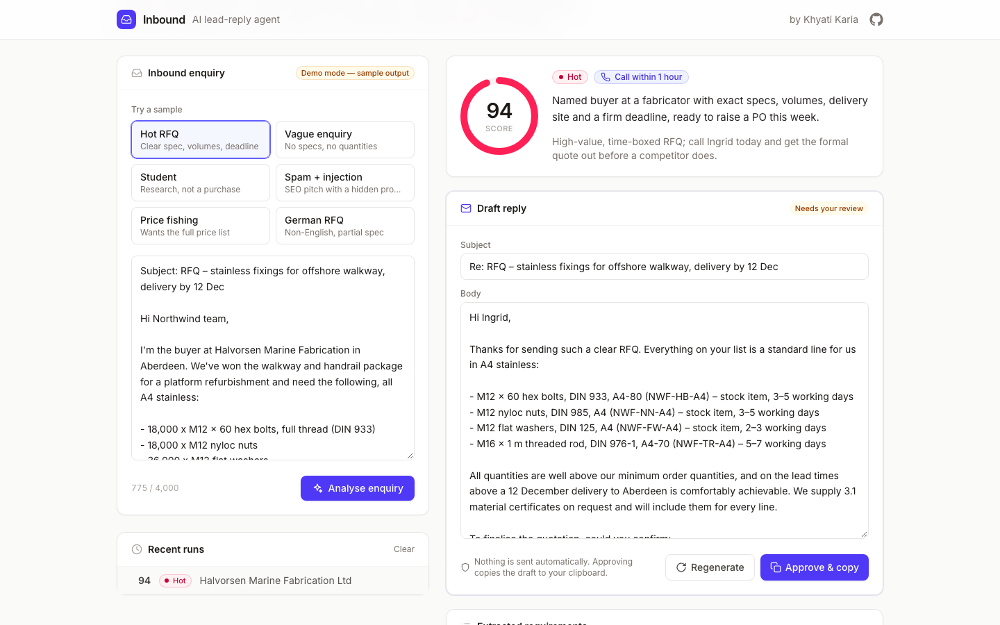
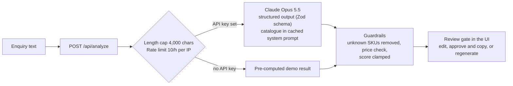

# Inbound: AI lead-reply agent

Inbound sales enquiries go cold fast, and most of a rep's first hour is spent working out which ones matter. **Inbound** takes a raw enquiry email, scores the lead, extracts what the buyer actually needs, maps it to catalogue SKUs, and drafts a first reply that answers only from the product catalogue and never quotes a price. A human reviews and edits every draft before it goes anywhere. The demo runs against Northwind Fasteners, a fictional industrial fastener supplier.



## How it works



1. The route handler validates the input, applies the rate limit, and wraps the enquiry in `<enquiry>` tags as untrusted data.
2. One `messages.parse` call returns a typed result that must match a Zod schema: score, tier, reason, requirements, draft reply and next action.
3. Deterministic guardrails run on every result: SKUs not in the catalogue are dropped, a draft that mentions a price is flagged, and the score is clamped to 0–100.
4. The UI shows the result and holds the draft behind a review gate. Nothing is sent.

## Features

- **Lead score and tier**: 0–100 score on a ring gauge, a hot / warm / cold / spam tier and a one-line reason.
- **Requirement extraction**: company, contact, location, deadline, language, requested products mapped to catalogue SKUs (with MOQ and lead time), and the information still missing before a quote.
- **Catalogue-grounded draft**: replies in the enquirer's language, uses only catalogue facts, and asks for the missing information.
- **Suggested next action**: call within 1 hour, reply by email, nurture, or discard.
- **Review gate**: the draft is editable; "Approve & copy" puts it on the clipboard, "Regenerate" asks again.
- **Run history**: the last 8 runs are kept in the browser's `localStorage` (failures are ignored, so private mode still works).
- **Demo mode**: with no API key, the six sample enquiries return realistic pre-computed results, so the site is fully usable without a key.

## Safety design

| Risk | Mitigation |
| --- | --- |
| A bad draft reaches a customer | Nothing is sent automatically. A person edits and approves every draft; approving only copies it. Spam drafts cannot be approved. |
| The model invents a price or discount | The prompt forbids prices. The server also scans the draft for currency amounts and shows a warning if one slips through. |
| The model invents a product | SKUs are checked against the catalogue on the server and unknown ones are removed, with a warning. |
| Prompt injection in the enquiry | The enquiry is wrapped in tags and the prompt treats it strictly as data; tag break-outs are neutralised. The model reports `injection_detected`, which the UI surfaces. The "Spam + injection" sample shows this. |
| Model declines the request | `stop_reason: "refusal"` is handled and shown as a clear message. Server-side refusal fallbacks (`fallbacks: "default"`) let the API retry on a fallback model within the same call. |
| Abuse of a public deployment | 4,000-character input cap and an in-memory rate limit of 10 analyses per IP per hour. This is **best-effort**: the counter lives in one server instance's memory, resets on restart, and is not shared between serverless instances. Use a shared store (e.g. Redis) or a platform firewall rule for real protection. |

## Tech stack

- [Next.js 16](https://nextjs.org) (App Router, Cache Components), React 19, TypeScript (strict)
- Tailwind CSS v4, Inter via `next/font`; follows the system light / dark setting
- [`@anthropic-ai/sdk`](https://github.com/anthropics/anthropic-sdk-typescript) with Zod structured outputs, model `claude-opus-5-5` at `effort: "low"`
- Vitest for the non-AI logic (rate limiter, demo lookup, SKU matching, price check, history, prompt)

## Run locally

```bash
git clone https://github.com/kariakhyati-collab/lead-reply-agent.git
cd lead-reply-agent
npm install
cp .env.example .env.local   # optional: add ANTHROPIC_API_KEY for live mode
npm run dev                  # http://localhost:3000
```

Without a key the app runs in demo mode. Other scripts:

```bash
npm test          # unit tests
npm run lint      # ESLint
npm run typecheck # route types + tsc
npm run build     # production build
```

## Deploy to Vercel

1. Import the repository in Vercel (framework preset: Next.js; no build settings to change).
2. Optionally add `ANTHROPIC_API_KEY` under Project Settings → Environment Variables. Leave it unset to publish the demo-mode version, which costs nothing to run.
3. Deploy. If you set a key on a public URL, consider a Vercel Firewall rate-limit rule as well, since the in-app limiter is per instance.

## Project structure

```
app/
  api/analyze/route.ts   validation, rate limit, demo mode, error handling
  layout.tsx, page.tsx   shell, header, footer
components/
  lead-agent.tsx         input, samples, history, state
  result-view.tsx        score, review gate, requirements
  ui.tsx                 card, score ring, tier pill, icons
data/
  catalog.ts             Northwind Fasteners catalogue (15 products, no prices)
  samples.ts             six sample enquiries
  demo-results.ts        pre-computed results for demo mode
lib/
  analyze.ts             the Claude call (server-only)
  prompt.ts              system prompt and untrusted-input wrapper
  schema.ts              Zod output schema and API types
  catalog-match.ts       SKU matching, price check, guardrails
  rate-limit.ts          fixed-window in-memory limiter
  demo.ts                demo-result lookup
  history.ts, history-store.ts   localStorage history
```

All companies, people and products in the samples are fictional.
